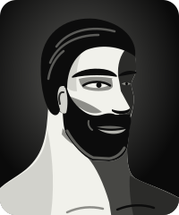

<p align="center">
  
</p>

<h1 align="center">chad</h1>

<p align="center">
  A Discord assistant that writes its own missing features in TypeScript.
</p>

<p align="center">
  <a href="#it-edits-itself">Self-editing</a> ·
  <a href="#deploy-to-a-cloud-server">Deploy</a> ·
  <a href="#run-with-docker">Docker</a> ·
  <a href="#docs">Docs</a>
</p>

Most self-hosted agents want half a home lab before they answer "hello." chad is a lighter alternative to Hermes: one process, one Docker image (`ghcr.io/tim-smart/chad`), and one `/data` volume. It runs on Node 26 with SQLite, built on Effect 4, `effect/chat`, `clanka`, and `dfx`.

Tell it in Discord what you need, and it writes the plugin and hot-swaps it on the next turn.

## It edits itself

Everything you customize lives in one git repo at `/data/repo/work`:

```text
/data/repo/work/
  plugins/<name>.ts       TypeScript plugins via Plugin.make (or plugins/<name>/index.ts)
  skills/<name>/SKILL.md  Markdown skills read on demand
  mcp.json                stdio and HTTP/OAuth MCP servers
  chad.json               plugin settings with ${SECRET} expansion
  package.json            npm packages (installed with npm ci --ignore-scripts)
  persona.md              system prompt persona
```

Plugins can register tools, Discord components (buttons, selects, modals), prompts, lifecycle hooks, and background fibers. Nothing takes effect until `chad apply` runs; until then it is just a draft.

`chad check` and `chad apply` format plugins with Prettier, type-check them with strict `tsc`, bundle them in memory with `esbuild`, and validate `chad.json`, `mcp.json` and the skills. An apply does all of that before it commits, so broken code gets rejected at the door while the live daemon keeps running. Passing changes hot-swap on the next turn with no container restart.

If chad still manages to paint itself into a corner at runtime, `chad revert` rolls back to any earlier applied commit while saving uncommitted drafts to a git ref. `/safe on` (or `chad safe on`, or `CHAD_SAFE_MODE=1` on startup) loads nothing from the repo, so no repo plugins, repo skills, or MCP servers, and you can fix the mess from Discord or the shell.

## Access and secrets

chad answers its owners and no one else. Each chat connection keeps an allowlist of Discord user IDs ([`docs/owners.md`](./docs/owners.md)); messages and button clicks from anyone else are silently ignored, and the messages are never stored.

It also doesn't ask for passwords in chat. When chad needs a credential, `requestSecret`, `requestOnce`, and `requestMcpLogin` post a button that opens a Discord form instead. A key saved through `requestSecret` goes straight to the secret store and never passes through the model, and an MCP server's OAuth sign-in is kept on the volume the same way. A one-off code from `requestOnce` goes to the script that asked for it and is saved nowhere, and chad masks that exact value in logs and script output. A password you paste into a message anyway is in the history like any other message, so change it.

## In the box

In DMs, just message chad. In server channels, an `@mention` opens an auto-titled thread where follow-ups need no mention (use `/mention off` for mention-free channels). Running turns post a live status message with a **Stop** button, and new messages steer an active turn. Built-in slash commands: `/new`, `/stop`, `/status`, `/model`, `/safe`, and `/mention`.

| Area                   | Included                                                                                                                                                                                                                                                                                                                               |
| ---------------------- | -------------------------------------------------------------------------------------------------------------------------------------------------------------------------------------------------------------------------------------------------------------------------------------------------------------------------------------- |
| **Bundled plugins**    | `cron` (one-shot and recurring timers, auto-paused on failures), `send-file`, `send-message`, `request-secret`, `request-mcp-login`, and `asphodel` (optional long-term memory, off by default). All six use the public plugin API and ship as source examples in `/data/repo/examples/`.                                              |
| **Models**             | Switch live with `/model` or `chad model`, which makes a trial request before it saves the change. Runs on a ChatGPT Codex login (default), the OpenAI API (`CHAD_OPENAI_API_KEY`), an OpenAI-compatible endpoint, or Google Antigravity (`chad login antigravity`). clanka's `copilot` and `xai` providers are accepted but untested. |
| **Preinstalled tools** | Dev (`git`, `gh`, `rg`, `fd`, `jq`, `nvim`, `sqlite3`, `uv`/`uvx`, `python3`), docs and PDFs (`pandoc`, `typst`, `poppler`, `qpdf`), and media (`magick`, `rsvg-convert`, `ffmpeg`, image optimizers). Full list in [`docs/running.md`](./docs/running.md).                                                                            |
| **Skills**             | Bundled skills (`self-edit`, `credentials`, `diagnose`) plus editable starter skills (`dev-tools`, `documents`, `images`, `pdfs`, `video`).                                                                                                                                                                                            |

## Deploy to a cloud server

[`docs/deploying.md`](./docs/deploying.md) puts chad on one DigitalOcean Droplet with `asphodel` for long-term memory and a live Chromium instance via the `browse` MCP. After lockdown, every public port is closed and Tailscale is the only way in.

1. [Create a Droplet](https://cloud.digitalocean.com/droplets/new?image=ubuntu-24-04-x64&size=s-2vcpu-4gb&region=nyc3) (Ubuntu 24.04, 2 vCPUs, 4 GB memory). Select your SSH key and paste [`deploy/cloud-init.yaml`](./deploy/cloud-init.yaml) under "Startup scripts".
2. Run `ssh root@<the Droplet's IP address>`, then `bash /opt/chad/install.sh`, and sign in to Tailscale at the link it prints.
3. Run `ssh root@chad`, then `bash /opt/chad/install.sh lockdown` to close the public ports.
4. In `/opt/chad`, run `docker compose exec chad chad setup` to connect Discord and log chad in to its model.

The guide covers each step in full, including asphodel setup, the browser, backups, and updating. The same installer runs on any Ubuntu 24.04 or Debian server.

## Run with Docker

```sh
docker volume create chad-data
docker run -d --name chad --restart unless-stopped --stop-timeout 90 \
  -v chad-data:/data \
  ghcr.io/tim-smart/chad:main
docker exec -it chad chad setup
```

`--stop-timeout 90` gives an active turn time to finish before Docker kills the container. `chad setup` connects Discord, sets the owner and the timezone, and offers to log chad in to Codex. [`docs/running.md`](./docs/running.md) covers pinned version and commit tags, Kubernetes deployments, extra mounts, and single-tar `chad backup` / `chad restore`.

## Docs

- [`docs/running.md`](./docs/running.md): running, backing up, and restoring the image.
- [`docs/deploying.md`](./docs/deploying.md): chad, asphodel, Chromium, and Tailscale on one cloud server.
- [`docs/owners.md`](./docs/owners.md): who chad answers.
- [`docs/live-checks.md`](./docs/live-checks.md): manual checks run against a real Discord, Codex login, and deployment.
- [`docs/codex-capture.md`](./docs/codex-capture.md): how the recorded Codex frames replayed by the tests are made.
- [`skills/`](./skills/): bundled skills chad ships with.
- [`starter-skills/`](./starter-skills/): starter skills copied into a new repo for images, PDFs, documents, video, and dev tools.
- [`AGENTS.md`](./AGENTS.md): the contract for anyone changing chad.

The `prototypes` branch holds throwaway prototypes from before the build. It is never merged.
